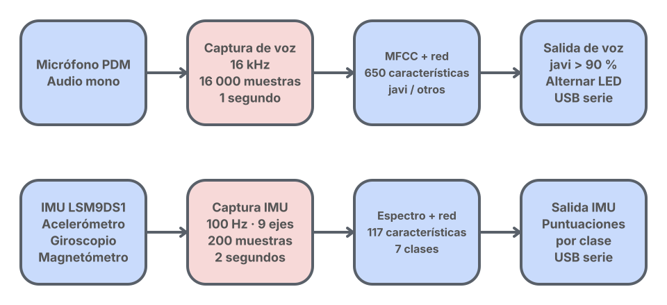
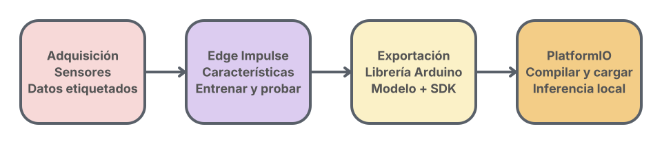
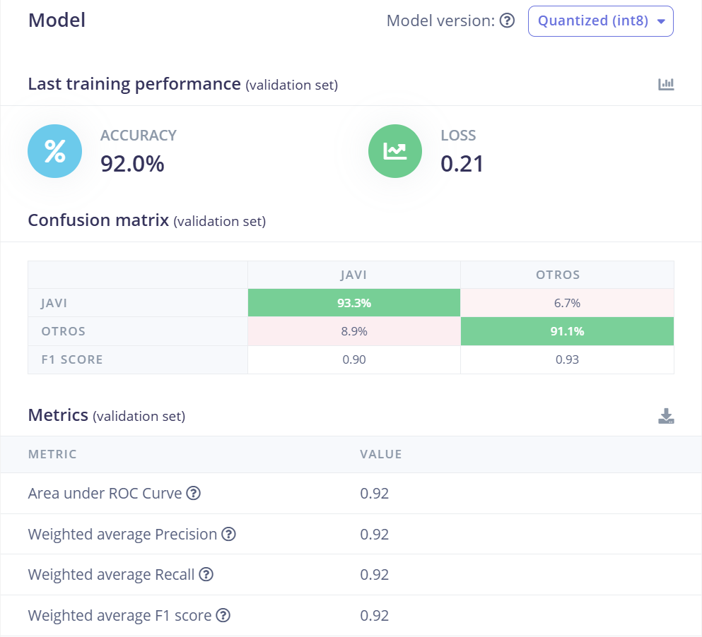
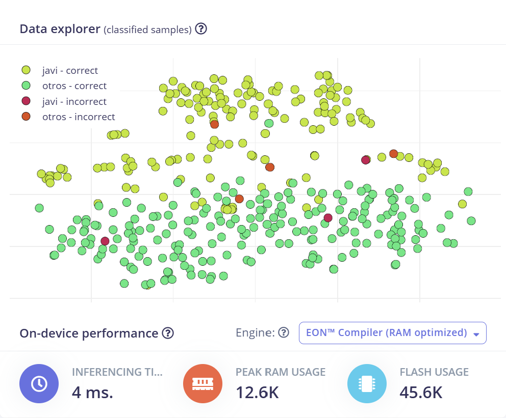
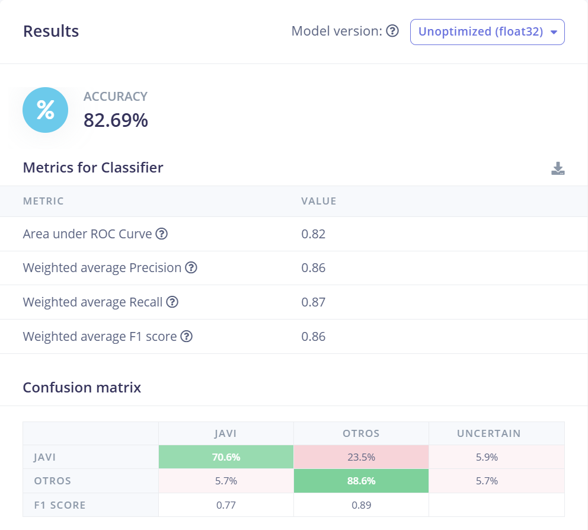
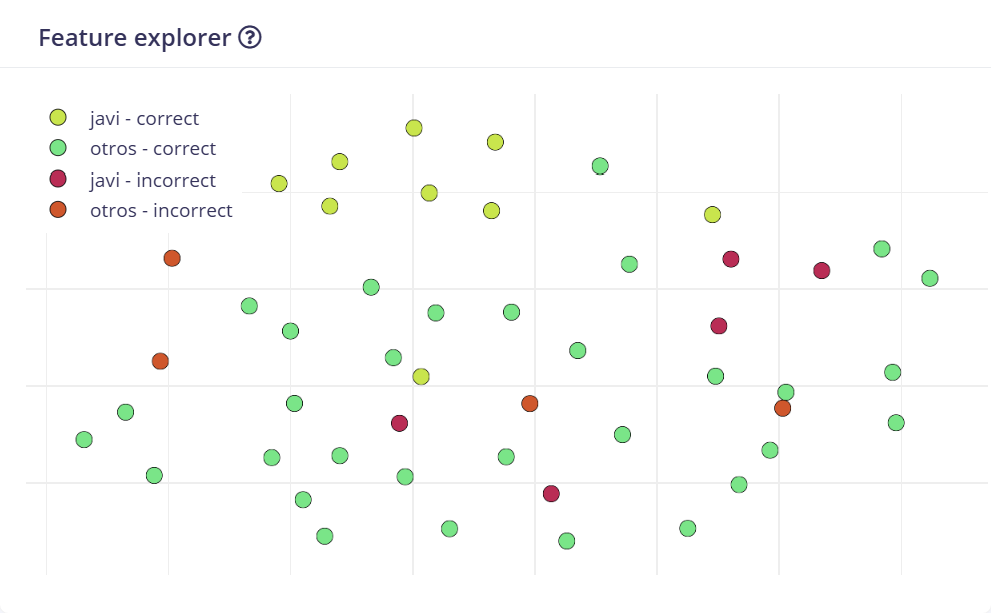
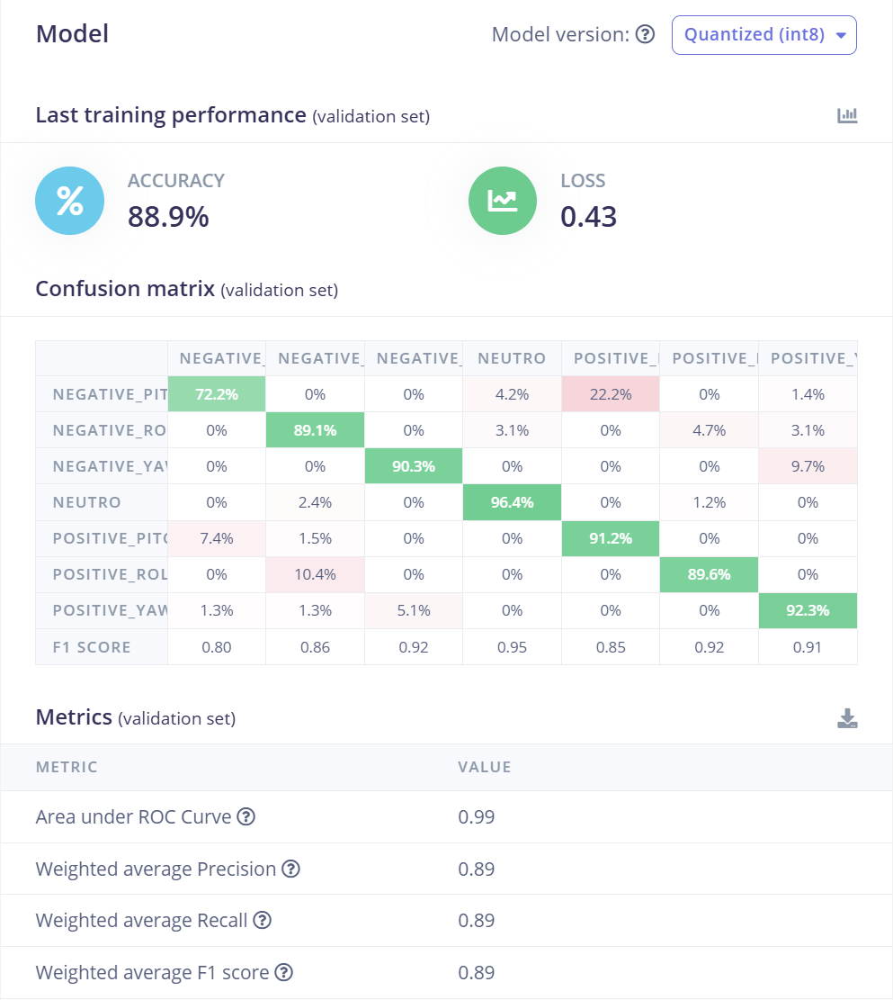
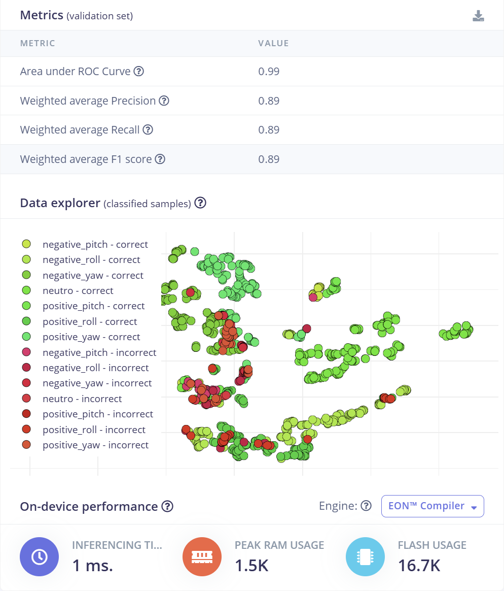
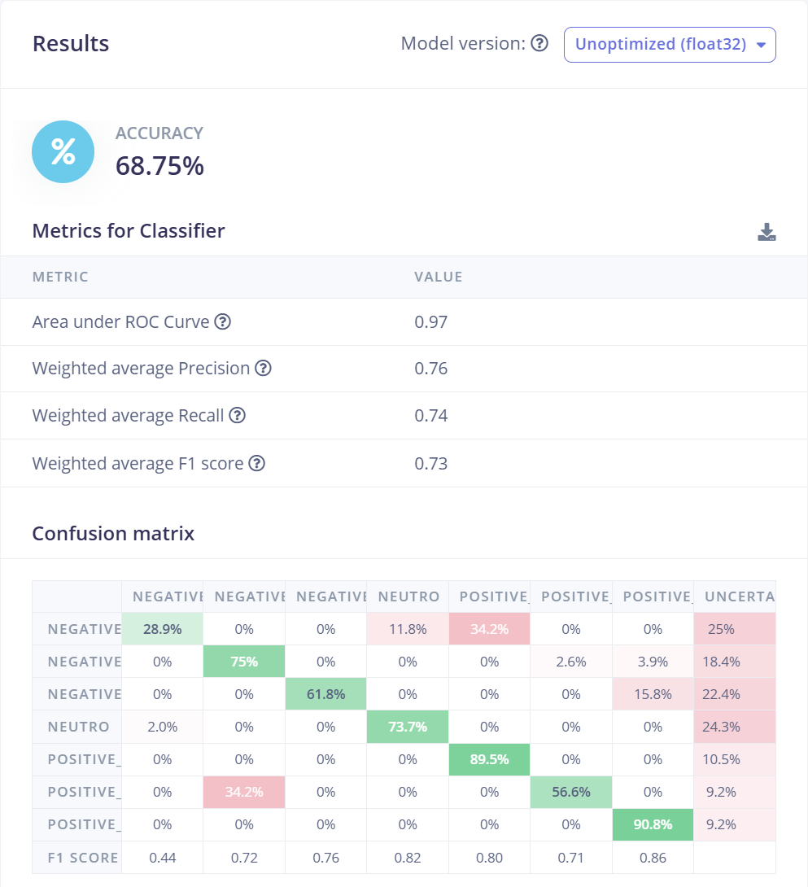
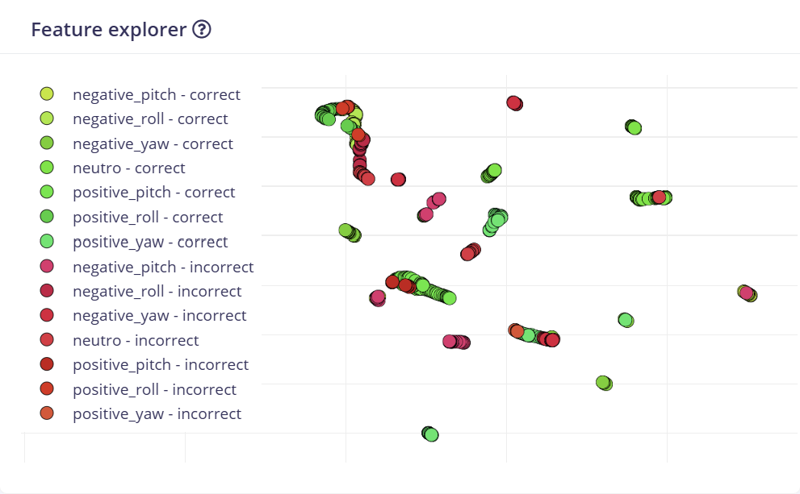

# Detección de voz y movimientos con Edge Impulse

<p align="justify">
Dos aplicaciones de aprendizaje automático embebido para la <strong>Arduino Nano 33 BLE Sense</strong>: una reconoce la palabra «javi» y cambia el estado del LED integrado; la otra clasifica movimientos de la IMU en siete clases. Los modelos se han exportado desde Edge Impulse y se ejecutan en la placa mediante proyectos independientes de PlatformIO.
</p>

| Aplicación | Entrada | Procesamiento | Resultado |
| --- | --- | --- | --- |
| [Detector de voz](JAVI-VOICE-DETECTOR/JAVI_DETECTOR/) | Micrófono PDM, audio mono a 16 kHz | MFCC y modelo `JAVI_inferencing` | Puntuaciones `javi` / `otros` y alternancia del LED |
| [Detector de movimientos](IMU_DETECTOR/) | Nueve ejes IMU; entrada del modelo a 100 Hz | Análisis espectral y modelo `IMU_TEST_inferencing` | Puntuaciones de siete clases por USB |

**Son dos firmwares separados:** se carga uno u otro en la placa. El proyecto actual no combina voz y movimiento en una misma aplicación.

<p align="center">
  <picture>
    <source media="(prefers-color-scheme: dark)" srcset="assets/diagramas/inferencia-claro.svg">
    <source media="(prefers-color-scheme: light)" srcset="assets/diagramas/inferencia-oscuro.svg">
    
  </picture>
</p>

## Contenido de la práctica

- [Cómo funciona el detector de voz](#cómo-funciona-el-detector-de-voz)
- [Cómo funciona el detector de movimientos](#cómo-funciona-el-detector-de-movimientos)
- [Compilar, cargar y observar los resultados](#compilar-cargar-y-observar-los-resultados)
- [Relación con Edge Impulse](#relación-con-edge-impulse)
- [Resultados de validación y test](#resultados-de-validación-y-test)
- [Organización de los archivos](#organización-de-los-archivos)
- [Estado y límites de la validación](#estado-y-límites-de-la-validación)

## Hardware y herramientas

Se utiliza la **Nano 33 BLE Sense original**, con micrófono PDM, IMU LSM9DS1 y LED integrados, conectada al ordenador mediante USB de datos. No requiere cableado externo para estas dos aplicaciones.

El entorno es **PlatformIO + framework Arduino**, con el identificador de placa `nano33ble`. Para compilar basta con las bibliotecas exportadas incluidas y las dependencias de cada proyecto. La integración de la IMU está escrita para la **LSM9DS1**; la **Sense Rev2** utiliza otra IMU y requiere adaptar esa parte del firmware.

## Cómo funciona el detector de voz

<p align="justify">
El programa busca la palabra «javi» en una ventana de audio. Es un clasificador de palabra objetivo: no identifica a una persona por su voz ni transcribe frases. La segunda clase, <code>otros</code>, representa la alternativa aprendida por el modelo; los archivos disponibles no documentan qué sonidos o hablantes se incluyeron al entrenarla.
</p>

### De la señal al cambio del LED

1. Al arrancar, el programa configura el LED apagado e inicia el micrófono en mono.
2. Un callback de PDM llena un buffer de **16 000 muestras PCM de 16 bits** a **16 000 Hz**: un segundo de audio, con un buffer principal de 32 000 bytes.
3. `run_classifier()` procesa la ventana: el bloque **MFCC** obtiene **650 características** y la red calcula las puntuaciones de `javi` y `otros`.
4. El monitor serie muestra ambas puntuaciones como porcentajes.
5. Si la puntuación de `javi` es **estrictamente superior a 0,90**, una nueva detección alterna el LED: apagado → encendido o encendido → apagado.

Las detecciones positivas consecutivas producen **una sola alternancia**. Para volver a cambiar el LED debe aparecer antes una clasificación con puntuación de `javi` menor o igual a 0,90. Esto evita alternar el LED varias veces por una secuencia de resultados positivos.

| Parámetro | Valor actual | Ubicación |
| --- | --- | --- |
| Clases | `javi`, `otros` | [Variables del modelo de voz](JAVI-VOICE-DETECTOR/JAVI_DETECTOR/lib/JAVI_inferencing/src/model-parameters/model_variables.h) |
| Muestreo y ventana | 16 kHz · 1 s · 16 000 muestras | [Metadatos del modelo de voz](JAVI-VOICE-DETECTOR/JAVI_DETECTOR/lib/JAVI_inferencing/src/model-parameters/model_metadata.h) |
| Umbral que controla el LED | `UMBRAL_JAVI = 0.90f`, comparación `>` | [Aplicación de voz](JAVI-VOICE-DETECTOR/JAVI_DETECTOR/src/main.cpp) |
| Plazo para completar la captura | `TIMEOUT_AUDIO_MS = 5000` | Aplicación de voz |
| Serie USB | 115 200 baudios | Aplicación de voz |

El timeout de cinco segundos detecta una captura que no consigue llenarse; **no apaga el LED tras cinco segundos**. Si falla la captura o la clasificación, el programa informa por serie y vuelve a intentarlo. Si no puede iniciar PDM, queda detenido.

<details>
<summary>Procesamiento y funciones del código de voz</summary>

El modelo utiliza **13 coeficientes MFCC**, tramas de 20 ms con paso de 20 ms, 32 filtros y FFT de 256 puntos. La exportación incluye el modelo cuantizado `int8` y su ejecución compilada con EON.

| Función | Responsabilidad |
| --- | --- |
| `recibirAudio()` | Recibir bloques PDM y copiar las muestras mientras está activa la grabación |
| `grabarAudio()` | Preparar una ventana completa y supervisar su timeout |
| `obtenerAudio()` | Entregar las muestras al clasificador mediante `signal_t` |
| `clasificarAudio()` | Ejecutar `run_classifier()` y comprobar errores |
| `gestionarDeteccion()` | Comparar el umbral y detectar el paso a una clasificación positiva |
| `alternarLed()` | Cambiar el estado del LED e imprimir el evento |

</details>

## Cómo funciona el detector de movimientos

<p align="justify">
La aplicación lee los tres sensores de la LSM9DS1 y construye una ventana de <strong>200 muestras de nueve ejes</strong>, equivalente a dos segundos nominales a 100 Hz. A partir de ella calcula características espectrales y ejecuta una red de siete clases.
</p>

### Entrada y unidades

El orden de los datos es obligatorio y se comprueba al iniciar el programa:

```text
accX, accY, accZ, gyrX, gyrY, gyrZ, magX, magY, magZ
```

| Sensor | Canales | Tratamiento antes de la inferencia |
| --- | --- | --- |
| Acelerómetro | `accX`, `accY`, `accZ` | Limitar cada eje a ±2 g y multiplicar por 9,80665 para obtener m/s² |
| Giroscopio | `gyrX`, `gyrY`, `gyrZ` | Lectura en grados/s |
| Magnetómetro | `magX`, `magY`, `magZ` | Lectura en µT |

El intervalo de entrada del modelo es **10 ms**. Cada ventana contiene **1800 valores** y el análisis espectral los reduce a **117 características**. Se conserva la última lectura disponible de cada sensor: en particular, el magnetómetro no aporta una lectura nueva en cada intervalo de 10 ms.

### Clases y salida

Las etiquetas exactas del modelo son:

| Grupo | Etiquetas |
| --- | --- |
| Pitch | `negative_pitch`, `positive_pitch` |
| Roll | `negative_roll`, `positive_roll` |
| Yaw | `negative_yaw`, `positive_yaw` |
| Neutro | `neutro` |

**Son clases aprendidas, no ángulos en grados.** El programa no calcula una orientación Euler ni aplica un filtro de estimación de actitud. La interpretación física de cada signo depende del montaje y de cómo se etiquetaron los ejemplos de entrenamiento.

Tras capturar la ventana, `numpy::signal_from_buffer()` prepara la señal y `run_classifier()` calcula las puntuaciones. Se imprimen las siete clases con cuatro decimales. **Todavía no se aplica un umbral ni se activa una acción según el movimiento.** El LED integrado únicamente señala que la inicialización se ha completado.

La configuración propia está en [include/config.h](IMU_DETECTOR/include/config.h); la frecuencia, la longitud de ventana y las clases proceden de los [metadatos](IMU_DETECTOR/IMU_TEST_inferencing/src/model-parameters/model_metadata.h) y las [variables del modelo](IMU_DETECTOR/IMU_TEST_inferencing/src/model-parameters/model_variables.h). El flujo completo está en [src/main.cpp](IMU_DETECTOR/src/main.cpp).

<details>
<summary>Bloque espectral y arquitectura de la red IMU</summary>

El bloque espectral usa los nueve ejes, FFT de longitud 16, sin filtro ni decimación, con logaritmo y solapamiento de FFT activados. Su salida tiene 117 características.

```text
117 características → Dense 20 + ReLU → Dense 10 + ReLU → Dense 7 → Softmax
```

El modelo está cuantizado con entrada y salida `int8` y compilado con EON. La exportación no habilita detección de anomalías. Los valores de umbral presentes en los metadatos no se aplican automáticamente como decisiones en `main.cpp`.

</details>

## Compilar, cargar y observar los resultados

Abre [P1_DETECTAR_VOZ.code-workspace](P1_DETECTAR_VOZ.code-workspace) en VS Code para trabajar con ambas aplicaciones, o abre **la carpeta que contiene el `platformio.ini` de la aplicación elegida**. También puedes usar los siguientes comandos desde `P1_DETECTAR_VOZ` si `pio` está disponible en la terminal.

### Detector de voz

Su [platformio.ini](JAVI-VOICE-DETECTOR/JAVI_DETECTOR/platformio.ini) contiene `build_dir = C:/Users/diego/PIO-build/JAVI`. En otro ordenador, **ajusta o elimina esa línea** para que PlatformIO use una ubicación adecuada.

```powershell
pio run -d ./JAVI-VOICE-DETECTOR/JAVI_DETECTOR -e nano33ble
pio run -d ./JAVI-VOICE-DETECTOR/JAVI_DETECTOR -e nano33ble --target upload
pio device monitor --baud 115200
```

Con el monitor abierto, pronuncia «javi» durante las capturas anunciadas con `Escuchando...`. Comprueba las puntuaciones y el mensaje de cambio de LED. Entre dos activaciones debe haber una clasificación que deje de superar el umbral.

### Detector de movimientos

Su [platformio.ini](IMU_DETECTOR/platformio.ini) fija `nordicnrf52@11.0.0`, `Arduino_LSM9DS1@1.1.1` y enlaza la carpeta local `IMU_TEST_inferencing` como biblioteca. Activa además la asignación estática del clasificador.

```powershell
pio run -d ./IMU_DETECTOR -e nano33ble
pio run -d ./IMU_DETECTOR -e nano33ble --target upload
pio device monitor --baud 115200
```

Mueve la placa con la orientación y montaje empleados al entrenar. Observa cómo cambian las siete puntuaciones. La guía específica está en [IMU_DETECTOR/INSTRUCCIONES.md](IMU_DETECTOR/INSTRUCCIONES.md).

**Si no aparece el puerto:** comprueba el cable USB de datos, cierra cualquier monitor serie o proceso de Edge Impulse que lo esté usando y prueba a pulsar RESET dos veces para entrar en el cargador de arranque. Si hay varios dispositivos, selecciona su puerto con `--port` en el monitor o `--upload-port` al cargar, sin asumir un número COM fijo.

## Relación con Edge Impulse

<p align="center">
  <picture>
    <source media="(prefers-color-scheme: dark)" srcset="assets/diagramas/flujo-desarrollo-claro.svg">
    <source media="(prefers-color-scheme: light)" srcset="assets/diagramas/flujo-desarrollo-oscuro.svg">
    
  </picture>
</p>

El flujo de trabajo consiste en recoger datos representativos, etiquetarlos, configurar el bloque de características y la red, entrenar y evaluar con datos independientes, y exportar una **biblioteca Arduino**. Esa exportación incorpora los pesos, el procesamiento de señal y el SDK que necesita la aplicación.

En esta carpeta están las exportaciones para ejecutar los modelos; **no están los datasets ni la configuración completa del entrenamiento**, por lo que no permite reproducir por sí sola todo el entrenamiento. Los informes de evaluación descargados se incluyen en la sección de resultados. Una vez cargada la aplicación, el cálculo de las predicciones se realiza localmente en el Arduino, sin enviar cada ventana a Edge Impulse.

### Para qué sirven las otras carpetas de IMU_DETECTOR

| Carpeta | Contenido y uso |
| --- | --- |
| [`IMU_TEST_inferencing/`](IMU_DETECTOR/IMU_TEST_inferencing/) | Tu modelo exportado, DSP, SDK y ejemplos para varias placas. Es la biblioteca que utiliza la aplicación PlatformIO. |
| [`herramientas/firmware-adquisicion/`](IMU_DETECTOR/herramientas/firmware-adquisicion/) | Firmware binario de Edge Impulse y scripts para cargarlo. Sirve para conectar la placa con las herramientas de adquisición. |
| [`herramientas/firmware-fuentes/`](IMU_DETECTOR/herramientas/firmware-fuentes/) | Código fuente de ese firmware auxiliar, con sensores, herramientas y SDK. No se compila como parte de `IMU_DETECTOR/src/main.cpp`. |

El firmware de adquisición y la aplicación de inferencia ocupan el mismo lugar en la placa: **cargar uno sustituye al otro**. Los ejemplos de la biblioteca exportada tampoco se ejecutan todos juntos; el punto de entrada de cada proyecto es su propio `src/main.cpp`.

Para actualizar una red, sustituye su biblioteca exportada conservando el nombre que incluye el programa, revisa ejes, frecuencia, unidades, límites y etiquetas, y vuelve a compilar. En voz, cambiar la etiqueta `javi` exige adaptar la búsqueda de esa clase; en IMU, cambiar el orden o número de ejes exige adaptar la adquisición.

## Resultados de validación y test

Las capturas muestran los resultados de Edge Impulse aportados para ambos proyectos. Se han **recortado sin modificar cifras, etiquetas ni puntos de los gráficos**, y se conservan las capturas originales de [voz](src/voz/originales/) e [IMU](src/imu/originales/) junto con su [procedencia y coordenadas de recorte](src/procedencia-resultados.json).

**Validación y test corresponden a conjuntos distintos.** Las capturas de validación usan el modelo **Quantized (int8)** y las de test **Unoptimized (float32)**. Por tanto, su diferencia no permite aislar el efecto de la cuantización.

### Voz: validación del modelo int8

<p align="center">
  
</p>

La validación alcanza **92,0 % de accuracy**, con pérdida **0,21** y F1 ponderado **0,92**. El [JSON de validación de voz](src/voz/javi-metricas-validacion.json) registra **75 elementos evaluados**: 30 de `javi` y 45 de `otros`. La matriz identifica correctamente el **93,3 % de `javi`** y el **91,1 % de `otros`**; el 8,9 % de los ejemplos `otros` se clasifica como `javi`.

<details>
<summary>Explorador y rendimiento estimado del modelo de voz</summary>

<p align="center">
  
</p>

El explorador permite localizar aciertos y errores en la proyección de características; la posición de los puntos no es una señal de audio ni representa una escala temporal. El panel **EON Compiler (RAM optimized)** muestra **4 ms**, **12.6K de RAM** y **45.6K de flash**. Son las cifras presentadas por Edge Impulse para ese perfil, no una medición independiente del firmware completo realizada en esta práctica.

</details>

### Voz: test del modelo float32

<p align="center">
  
</p>

La captura de test muestra **82,69 % de accuracy**, ROC AUC **0,82** y F1 ponderado **0,86**. El **70,6 % de `javi`** se reconoce como tal, frente al **88,6 % de `otros`**. Un 23,5 % de `javi` se clasifica como `otros` y aparece un 5,9 % como `uncertain`: en este test, la palabra objetivo es el punto que más conviene reforzar con nuevos ejemplos representativos.

La puntuación de validación por sí sola no garantiza que el LED responda igual en uso real: el firmware aplica además su propio umbral **`javi > 0,90`** y la lógica que evita alternancias positivas consecutivas.

<details>
<summary>Explorador del test de voz</summary>

<p align="center">
  
</p>

La leyenda distingue aciertos y errores de las dos clases. Esta visualización ayuda a localizar casos conflictivos; no sustituye a las métricas ni demuestra el comportamiento con todos los hablantes o ambientes.

</details>

### IMU: validación del modelo int8

<p align="center">
  
</p>

La validación alcanza **88,9 % de accuracy**, con pérdida **0,43**, ROC AUC **0,99** y F1 ponderado **0,89**. El [JSON de validación IMU](src/imu/imu-metricas-validacion.json) contiene **494 elementos evaluados**. `neutro` obtiene un 96,4 % de aciertos y `negative_pitch` queda en **72,2 %**: su principal confusión es con `positive_pitch`, con un **22,2 %** de sus ejemplos.

<details>
<summary>Explorador y rendimiento estimado del modelo IMU</summary>

<p align="center">
  
</p>

El explorador reúne aciertos y errores de las siete etiquetas. El panel **EON Compiler** muestra **1 ms**, **1.5K de RAM** y **16.7K de flash** para el perfil seleccionado. Estas cifras describen el perfil del modelo mostrado por Edge Impulse; no son el consumo total de la aplicación PlatformIO, que incluye adquisición, SDK, buffers y framework.

</details>

### IMU: test del modelo float32

<p align="center">
  
</p>

La captura muestra **68,75 % de accuracy**, ROC AUC **0,97** y F1 ponderado **0,73**. Hay diferencias claras entre clases: `positive_yaw` alcanza el **90,8 %**, mientras que `negative_pitch` queda en **28,9 %**, con un **34,2 %** clasificado como `positive_pitch` y un **25 %** como `uncertain`. También se observa confusión de `positive_roll` con `negative_roll` (**34,2 %**).

Estos errores aconsejan revisar la consistencia del montaje y los signos usados al etiquetar, y ampliar las muestras de los pares más confundidos. Las capturas no bastan para determinar por sí solas la causa del error.

<details>
<summary>Explorador del test IMU</summary>

<p align="center">
  
</p>

Los puntos correctos e incorrectos muestran casos que el modelo separa y otros que confunde en esta proyección. Deben interpretarse junto con la matriz, sin atribuir significado físico a los ejes de la representación.

</details>

### Informes JSON y diferencias con las capturas

Las descargas repetidas de cada proyecto contienen las mismas métricas; antes de retirarlas se comprobó su igualdad con el informe completo conservado. Cada archivo contiene a la vez `validation` (variantes `int8` y `float32`) y `test` (solo `float32`). Se conserva una copia completa con nombre descriptivo y se eliminan las descargas duplicadas. Se incluyen además dos archivos derivados que separan las secciones **sin recalcular sus métricas**.

| Proyecto | Informe completo | Validación extraída | Test extraído |
| --- | --- | --- | --- |
| Voz | [javi-evaluacion-completa.json](src/voz/javi-evaluacion-completa.json) | [javi-metricas-validacion.json](src/voz/javi-metricas-validacion.json) | [javi-metricas-test.json](src/voz/javi-metricas-test.json) |
| IMU | [imu-evaluacion-completa.json](src/imu/imu-evaluacion-completa.json) | [imu-metricas-validacion.json](src/imu/imu-metricas-validacion.json) | [imu-metricas-test.json](src/imu/imu-metricas-test.json) |

| Proyecto y conjunto | Variante | Accuracy en captura | Accuracy en `classification_report` del JSON | Elementos del informe |
| --- | --- | --- | --- | --- |
| Voz · validación | int8 | 92,0 % | 92,00 % | 75 |
| Voz · test | float32 | 82,69 % | 86,54 % | 52 |
| IMU · validación | int8 | 88,9 % | 88,87 % | 494 |
| IMU · test | float32 | 68,75 % | 73,85 % | 608 |

Las matrices de test de las capturas incorporan una columna **`uncertain`**, que no aparece en las matrices exportadas de los JSON. Se documentan ambos resultados por separado: no se reemplaza la accuracy de la captura por la del informe ni se reconstruye una matriz mezclando las dos fuentes. Sin la configuración de evaluación de cada vista, no se puede asegurar la causa exacta de la discrepancia.

Las variantes de **validación float32** incluidas en los informes registran 93,33 % para voz y 90,89 % para IMU. Los informes aportados **no incluyen test int8**. Los valores `support` se describen como elementos evaluados; no se presupone que cada elemento sea una grabación original independiente.

## Organización de los archivos

```text
VOICE_MOVEMENT_DETECTOR/
├── README.md
├── P1_DETECTAR_VOZ.code-workspace     # Abre las dos aplicaciones en VS Code
├── .gitignore
├── assets/diagramas/                 # Diagramas SVG y sus JSON editables
├── src/                             # Resultados y documentación gráfica
│   ├── procedencia-resultados.json
│   ├── voz/                         # Capturas y métricas del detector de voz
│   │   └── originales/              # Capturas completas sin modificar
│   └── imu/                         # Capturas y métricas del detector IMU
│       └── originales/
├── JAVI-VOICE-DETECTOR/              # Código del proyecto original de voz
│   ├── README.md
│   └── JAVI_DETECTOR/                # Proyecto PlatformIO de voz
│       ├── platformio.ini
│       ├── src/main.cpp
│       └── lib/JAVI_inferencing/
└── IMU_DETECTOR/                     # Proyecto PlatformIO de movimiento
    ├── platformio.ini
    ├── INSTRUCCIONES.md
    ├── include/config.h
    ├── src/main.cpp
    ├── IMU_TEST_inferencing/
    └── herramientas/
        ├── firmware-adquisicion/    # Binario y scripts de carga
        └── firmware-fuentes/        # Fuentes del firmware auxiliar
```

La carpeta raíz `src/` contiene resultados, mientras que `src/` dentro de cada aplicación contiene su firmware. Las cachés `.pio/` se regeneran al compilar y quedan excluidas por `.gitignore`. Ambas aplicaciones se distribuyen completas dentro de este repositorio. Los JSON de los diagramas permiten regenerar sus dos variantes SVG; `-claro.svg` corresponde a trazos claros para el tema oscuro y `-oscuro.svg` a trazos oscuros para el tema claro.

## Estado y límites de la validación

| Aspecto | Evidencia disponible |
| --- | --- |
| Voz | Aplicación y modelo exportado presentes; el comportamiento descrito se ha contrastado con el código. No se ha repetido su compilación al preparar este README. |
| IMU | Compilación PlatformIO realizada el 4 de noviembre de 2026: 53 904 bytes de RAM (20,6 %) y 150 992 bytes de flash (15,4 %). Esta comprobación valida la construcción del firmware. |
| Rendimiento del reconocimiento | Se incluyen capturas e informes JSON de validación y test de ambos modelos. Las variantes, conjuntos y discrepancias se detallan arriba; no constituyen un ensayo independiente del firmware en la placa. |

Ambas aplicaciones capturan una ventana completa y después ejecutan la clasificación: **hay huecos de adquisición durante la inferencia y la salida serie**. La frecuencia de muestreo no equivale a la frecuencia de entrega de predicciones. En la IMU, conservar la última lectura tampoco aumenta la frecuencia física del magnetómetro.

La validación práctica debe comprobar el comportamiento con nuevas voces o movimientos y las mismas condiciones de montaje, orientación, unidades y rangos que se usaron para entrenar. Las bibliotecas generadas conservan sus avisos y condiciones de Edge Impulse; este README no asigna una licencia nueva al conjunto del proyecto.
